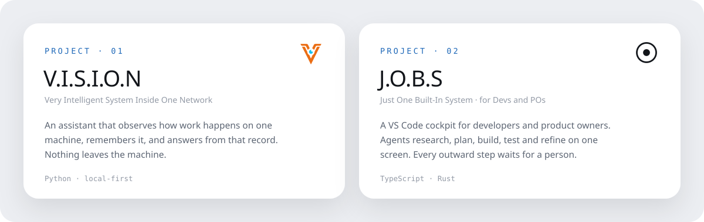
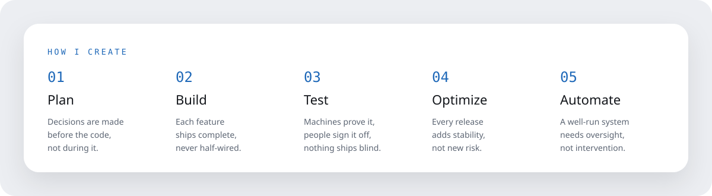

<picture>
  <source media="(prefers-color-scheme: dark)" srcset="assets/hero-dark-46106ce6.svg">
  
</picture>

 

<picture>
  <source media="(prefers-color-scheme: dark)" srcset="assets/projects-dark-b4e76c0f.svg">
  
</picture>

 

<picture>
  <source media="(prefers-color-scheme: dark)" srcset="assets/build-dark-51768ec6.svg">
  
</picture>

 

Engineered by Filipe, built by V.I.S.I.O.N.

