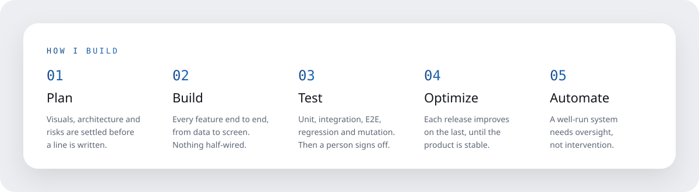

<picture>
  <source media="(prefers-color-scheme: dark)" srcset="assets/hero-dark-85f29d40.svg">
  
</picture>

 

<picture>
  <source media="(prefers-color-scheme: dark)" srcset="assets/projects-dark-a2386f9e.svg">
  
</picture>

 

<picture>
  <source media="(prefers-color-scheme: dark)" srcset="assets/build-dark-7baf5838.svg">
  
</picture>

 

Engineered by Filipe, built by V.I.S.I.O.N.

